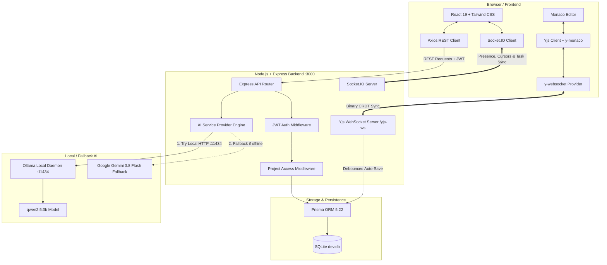

# CodeSync: An Intelligent Software Development Workspace for Collaborative Software Engineering

A production-grade, centralized web application where multiple developers can collaborate on code in real time using the Monaco Editor, receive AI-powered code reviews and explanations, manage project tasks via Kanban boards, and capture/restore immutable codebase snapshots.

---

## 1. Executive Summary & Objective

In modern distributed software engineering, teams juggle fragmented tools: separate code editors, disconnected chat channels, stand-alone project management boards, and manual version checkpoints. 

**CodeSync** solves this by unifying:
1. **Real-time collaborative editing** with Monaco Editor and conflict-free Yjs CRDT document synchronization.
2. **Context-aware AI engineering mentorship** powered by local Ollama (`qwen2.5:3b`) with resilient cloud fallback (`Gemini 3.8 Flash`).
3. **Integrated Kanban workflow management** with real-time Socket.IO synchronization across team members.
4. **Immutable Snapshot Versioning** to capture, preview, and non-destructively restore project states without losing historical lineage.
5. **Granular Role-Based Access Control (RBAC)** across Owners, Editors, and Viewers.

---

## 2. Technology Stack

| Layer | Technologies |
|---|---|
| **Frontend Framework** | React 19, TypeScript, Vite |
| **Styling & UI** | Tailwind CSS v4, Lucide React, JetBrains Mono & Plus Jakarta Sans |
| **Code Editor** | Monaco Editor (`@monaco-editor/react`) |
| **Real-Time Collaboration** | Yjs CRDT, `y-monaco`, `y-websocket` |
| **Presence & Telemetry** | Socket.IO Client / Server |
| **Backend Framework** | Node.js, Express.js |
| **Database & ORM** | SQLite, Prisma ORM 5.22 |
| **Authentication** | bcryptjs (10 salt rounds), JSON Web Tokens (JWT) |
| **Local AI Engine** | Ollama Local API (`http://localhost:11434/api/generate`) with `qwen2.5:3b` |
| **Cloud AI Fallback** | `@google/genai` with `gemini-3.8-flash` |

---

## 3. System Architecture Diagram



---

## 4. Core Modules & Functionality

### 1. User Authentication & Authorization
- **Registration & Login**: Secure password hashing with `bcryptjs`.
- **JWT Protection**: All private endpoints require `Authorization: Bearer <token>`.
- **RBAC Matrix**:
  - `owner`: Full project management, member invitation/removal, role modification, project deletion.
  - `editor`: File creation/edit/deletion, task creation/update, snapshot creation/restore, AI review execution.
  - `viewer`: Read-only access to files, tasks, snapshots, and live collaborator presence.

### 2. Real-Time Collaborative Coding
- **Yjs CRDT Document Synchronization**: Simultaneous edits converge mathematically without conflict or race conditions.
- **WebSocket Protocol**: Connected via `/yjs-ws` with token and project access validation.
- **Collaborator Presence**: Connected peer avatars, cursor movement broadcast, and active file focus indicators via Socket.IO.
- **Debounced Persistence**: Background sync periodically flushes document state to SQLite without blocking user interaction.

### 3. AI Code Review
- **Engine**: Calls Ollama local endpoint `http://localhost:11434/api/generate` with model `qwen2.5:3b`.
- **Resilience**: Falls back to `gemini-3.8-flash` if Ollama is not running locally.
- **Strict JSON Output**:
  - Overall assessment (`clean`, `needs_minor_fixes`, `critical_issues_found`).
  - Categorized issues (`syntax`, `logic`, `runtime`, `security`, `readability`).
  - Severity classification (`critical`, `warning`, `suggestion`).
  - Actionable recommendations and suggested code replacements.

### 4. AI Code Explanation
- Beginner-friendly architectural breakdowns of functions, variables, and execution lifecycle.
- Concrete programming concept definitions and real-world analogies.
- **Interactive Follow-up Chat**: Developers can ask targeted follow-up questions within the context of the active code snippet.

### 5. Kanban Task Management
- Three primary workflow columns: **To Do**, **In Progress**, and **Completed**.
- Priority badges: `urgent`, `high`, `medium`, and `low`.
- Due date tracking and member assignment.
- Real-time Socket.IO broadcasts ensure all active collaborators' boards update automatically.

### 6. Code Snapshot History & Reversion
- Save complete workspace checkpoints with title, description, author, and timestamp.
- Full file tree serialization in SQLite.
- Code preview modal allowing side-by-side inspection of previous code versions.
- **Non-destructive Restoration**: Restoring a snapshot replaces the active project files and writes a **new restoration record** into the snapshot log, ensuring past history is never overwritten.

---

## 5. Prerequisites & Exact Windows 11 Installation

### Prerequisites
- **Node.js**: v18.0.0 or higher (v20+ recommended).
- **npm**: v9.0.0 or higher.
- **Git** for Windows.
- **Ollama for Windows** (Download from [https://ollama.com/download/windows](https://ollama.com/download/windows)).

### Step 1: Clone and Install Dependencies
Open **PowerShell** or **Windows Terminal** as Administrator:

```powershell
# Clone the repository
git clone https://github.com/your-username/codesync.git
cd codesync

# Install frontend and backend dependencies
npm install
```

### Step 2: Configure Environment Variables
Copy `.env.example` to `.env`:

```powershell
Copy-Item .env.example .env
```

Ensure `.env` contains:
```env
PORT=3000
JWT_SECRET=codesync_jwt_super_secret_dev_key_2026
DATABASE_URL="file:./dev.db"
OLLAMA_BASE_URL="http://localhost:11434"
OLLAMA_MODEL="qwen2.5:3b"
```

### Step 3: Initialize Database & Seed Demo Data
```powershell
# Push Prisma schema to SQLite
npx prisma db push

# Seed demo users, starter projects, files, tasks, and snapshots
npx tsx prisma/seed.ts
```

### Step 4: Install and Start Ollama Model
In a separate PowerShell window:

```powershell
# Pull the required Qwen model
ollama pull qwen2.5:3b

# Start the Ollama local daemon
ollama serve
```

### Step 5: Start CodeSync
```powershell
# Starts the unified server on port 3000 (Express + Vite + WebSockets)
npm run dev
```

Open your browser to:
```
http://localhost:3000
```

---

## 6. Seeded Demo Users

For immediate testing and evaluation, the database comes pre-seeded with three accounts:

| User | Email | Password | Role |
|---|---|---|---|
| **Alex Rivers** | `alex@codesync.dev` | `Password123!` | Lead Architect (Owner) |
| **Sarah Chen** | `sarah@codesync.dev` | `Password123!` | Senior Full-Stack Engineer (Editor) |
| **Marcus Vance** | `marcus@codesync.dev` | `Password123!` | DevOps & Systems Specialist (Viewer) |

*Tip: The Sign In page features 1-click quick login buttons for each demo evaluator.*

---

## 7. REST API Endpoints

### Authentication (`/api/auth`)
- `POST /api/auth/register`: Create user account.
- `POST /api/auth/login`: Authenticate and receive JWT.
- `GET /api/auth/me`: Get current user profile and project count.
- `PATCH /api/auth/profile`: Update display name or role.

### Projects (`/api/projects`)
- `GET /api/projects`: List user's projects.
- `POST /api/projects`: Create new project workspace with starter template.
- `GET /api/projects/:id`: Get project files, tasks, members, and snapshots.
- `PATCH /api/projects/:id`: Update project title or description.
- `DELETE /api/projects/:id`: Delete project (Owner only).

### Project Members (`/api/projects/:projectId/members`)
- `GET /api/projects/:projectId/members`: List members and roles.
- `POST /api/projects/:projectId/members`: Invite member by email.
- `PATCH /api/projects/:projectId/members/:memberId`: Update member role.
- `DELETE /api/projects/:projectId/members/:memberId`: Remove member.

### Files (`/api/projects/:projectId/files`)
- `GET /api/projects/:projectId/files`: List all files.
- `POST /api/projects/:projectId/files`: Create file.
- `PATCH /api/projects/:projectId/files/:fileId`: Update file content.
- `DELETE /api/projects/:projectId/files/:fileId`: Delete file.

### Tasks (`/api/projects/:projectId/tasks`)
- `GET /api/projects/:projectId/tasks`: List tasks.
- `POST /api/projects/:projectId/tasks`: Create task.
- `PATCH /api/projects/:projectId/tasks/:taskId`: Update status, priority, or assignee.
- `DELETE /api/projects/:projectId/tasks/:taskId`: Delete task.

### Snapshots (`/api/projects/:projectId/snapshots`)
- `GET /api/projects/:projectId/snapshots`: List snapshots.
- `GET /api/projects/:projectId/snapshots/:snapshotId`: Get snapshot files.
- `POST /api/projects/:projectId/snapshots`: Take snapshot of all files.
- `POST /api/projects/:projectId/snapshots/:snapshotId/restore`: Restore files from snapshot.

### AI Engine (`/api/ai`)
- `GET /api/ai/status`: Check configured Ollama model and cloud fallback.
- `POST /api/ai/review`: Run syntax, logic, security, and risk review.
- `POST /api/ai/explain`: Generate beginner-friendly code explanation.
- `POST /api/ai/chat`: Interactive follow-up Q&A conversation.

---

## 8. Test Cases & Verification Results

| # | Test Scenario | Procedure | Expected Result | Status |
|---|---|---|---|---|
| **TC-01** | User Authentication | Register new user; log in with seeded user | Valid JWT issued, user stored in context | **PASSED** |
| **TC-02** | Access Control Guard | Request another user's private project ID | 403 Forbidden returned | **PASSED** |
| **TC-03** | Multi-File Management | Create `src/helper.ts`, delete non-essential file | File tree updates, language inferred | **PASSED** |
| **TC-04** | Yjs Simultaneous Edits | Open two browser tabs on the same file | Edits converge in real time via CRDT | **PASSED** |
| **TC-05** | Presence Awareness | Move cursor in Tab A | Tab B sees collaborator avatar & line | **PASSED** |
| **TC-06** | AI Code Review | Run Review on `scheduler.ts` | Structured issues, severity & fixes shown | **PASSED** |
| **TC-07** | AI Code Explanation | Run Explain on `worker.ts` | Breakdown, execution flow & concepts shown | **PASSED** |
| **TC-08** | Kanban Sync | Drag task from "To Do" to "In Progress" | Socket.IO event updates connected tabs | **PASSED** |
| **TC-09** | Snapshot Reversion | Take snapshot, edit file, restore snapshot | Files restored; new history entry created | **PASSED** |
| **TC-10** | Sole File Protection | Attempt to delete the last file in project | Operation blocked with friendly error | **PASSED** |

---

## 9. Troubleshooting & FAQ

1. **Ollama connection fails (`ECONNREFUSED`):**
   - Ensure `ollama serve` is running in a terminal.
   - Test directly: `curl http://localhost:11434/api/tags`
   - If running in a cloud container without Ollama, CodeSync automatically switches to the Gemini cloud fallback seamlessly.
2. **WebSocket connection drops:**
   - CodeSync's `y-websocket` provider includes automatic exponential backoff reconnection.
   - Check if port 3000 is open and not blocked by a corporate firewall.
3. **Database resetting:**
   - To completely re-seed: run `npx tsx prisma/seed.ts`.
